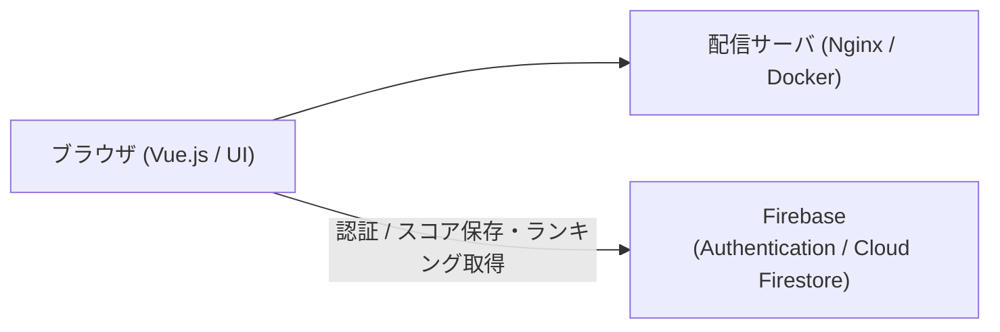

# BaseballGame

ブラウザで遊ぶ野球ゲーム「満塁野球」です。満塁の場面で、自動で投げられるボールを「打つ」ボタンで打ち返し、3アウトまでの得点を競います。

## 主な機能

- 打球が当たった的に応じて、1〜4点の得点か1〜3個のアウトになります。的に当たらずに画面の上端まで飛んだ打球もアウトです。的の数は画面幅に合わせて2〜4個に変わります。
- Googleアカウント（Firebase Authentication）でログインするか、ゲストとして遊べます。
- 結果をCloud Firestoreに保存し、直近7日間（画面上は「今週」）と歴代の得点ランキングを上位10件ずつ表示します。記録はログインユーザー・ゲスト番号ごとに1件で、保存すると上書きします。ログインユーザーは自分の記録を削除できます。

## バットの当たり判定

ボールは半径20pxの円で、バットのグリップ側の端から62px右を上から下へ動きます。バットは「打つ」を押すと、グリップ側の端を中心に画面上で反時計回りに回ります。


| 項目 | 仕様 |
| --- | --- |
| 判定に使うバットの形 | バットの画像の要素の枠（幅20px・長さ120pxの長方形）を回転させたもの。位置は、回転前の要素の位置と回転角から求める |
| スイング | 「打つ」を押すと-10度を描き、10msごとに10度ずつ描き替える。-100度に達したら描かずに0度へ戻す |
| 当たり | ボールがバットの枠に重なる（ボールの中心が枠から20px以内にある）。バットが水平のときは、ボールの中心が上のラインの20px上から40px下まで |
| 判定する間隔 | ボールを動かす30msごと。前回の判定から今回の判定までの間に触れた場合も当たり |


30msの間にバットは3回描き替わるため、前回と今回の判定の時点ではどちらも触れていないのに、その間にバットがボールを通り過ぎることがあります。前回の判定から今回の判定までを次のようにみなして調べ、間で触れていれば当たりにします。

- ボールは、前回の判定の位置から今回の判定の位置まで一定の速さで動く。
- バットは描いた角度に止まっていて、振る向きに描き替えた瞬間に、その間の角度を通る。振り終えて0度に戻るときは、間の角度を通らない。


## ゲスト番号

未ログインで開始画面を開いたときに、Firestoreの `guests/_sequence` にある `lastNumber` をトランザクションで1つ増やして発番します。取得した番号を開始画面に表示し、開始ボタン・再プレイでは再利用します。画面を開くだけでも番号を1つ消費します。ログイン済みの場合は画面表示時に発番しません。初回のみ既存ゲストIDの最大番号を1件取得して引き継ぎ、通常の発番で件数集計や全件取得は行いません。

発番にはオンライン接続とカウンターの読み書き権限が必要です。通信・利用枠の問題で発番できない場合は開始画面から再試行でき、ランダム番号での代用はしません。通信断や保存せず終了したプレイにより、ランキングに並ぶ番号には欠番が生じます。

カウンターはランキング用のフィールドを持たず、ランキングには表示されません。発行済み番号の再利用を防ぐため、`guests/_sequence` を削除したり `lastNumber` を減らしたりしないでください。ゲストのスコア用ドキュメントは結果保存時に作成します。

## システム構成



| 区分 | 使用技術 |
| --- | --- |
| 画面 | Vue.js 2・Bootstrap 5（どちらもCDNから読み込む） |
| ビルド | webpack、Babel、Gulp、Dart Sass |
| 外部サービス・配信 | Firebase（Authentication・Cloud Firestore・Analytics）、Nginx、Docker Compose |

## 開発環境のセットアップ

Node.js 24を使います。Firebaseの接続設定は `application/.env` に書きます。キーは `application/src/application/firebase/index.js` が読む `FIREBASE_` で始まる環境変数で、値はビルド時にdotenv-webpackがバンドルへ埋め込みます。

### 1. 依存パッケージのインストール

```bash
cd application
yarn install
```

### 2. ローカル開発サーバの起動

```bash
# Webpack Dev Server を起動（JS・SCSS・画像の変更でライブリロード）
yarn gulp
```

ブラウザで `http://localhost:4000` を開きます。

### 3. Docker Compose による配信確認

```bash
# プロジェクトルートで実行
docker compose up -d
```

Nginxが `application/dist`（`yarn gulp` の出力）を `https://localhost` で配信します。証明書はイメージの作成時に生成する自己署名証明書のため、ブラウザが警告を表示します。

## ビルドとテスト

```bash
cd application

# 本番用ビルド（静的解析・バンドル・スタイル生成）
yarn gulp:build

# 本番用ビルドの後に単体テストを実行
yarn test

# lint・整形の確認
yarn lint
yarn format:check
```

## ディレクトリ構成

```text
BaseballGame/
├── application/             # ゲームクライアントのソースコード
│   ├── src/                 # 画面（index.html・Vueインスタンス）、ゲーム進行、Firebase連携
│   ├── tests/               # 単体テスト（node:test）と、Firebaseをモックしたブラウザ確認用ビルド
│   └── package.json
├── docs/images/             # READMEの図（バットの当たり判定）
├── web/                     # NginxのDockerfileと設定
└── docker-compose.yaml      # コンテナ実行定義
```