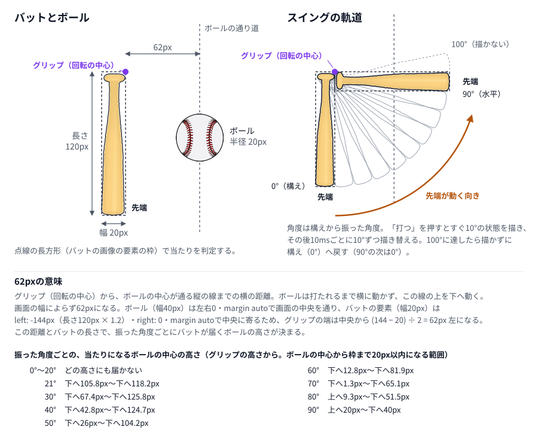
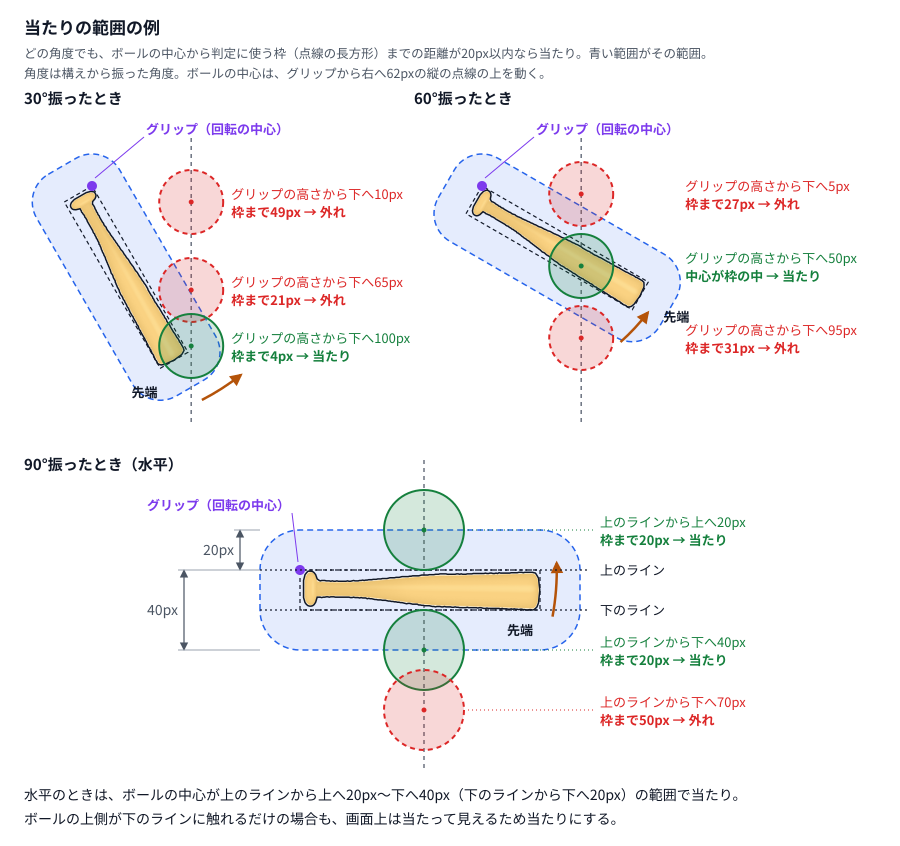
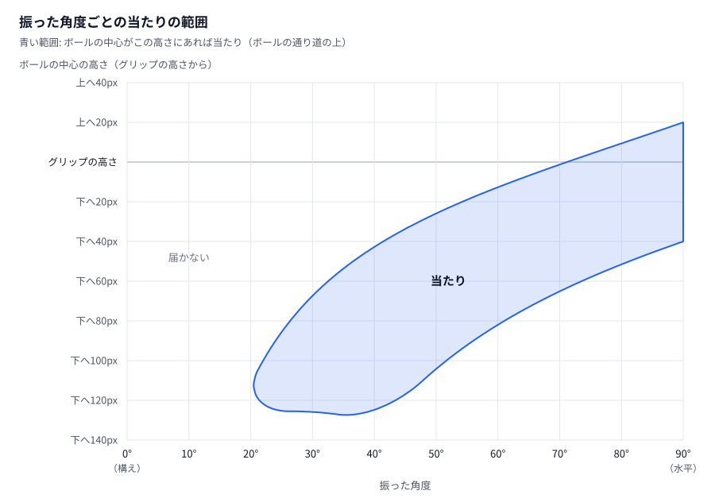
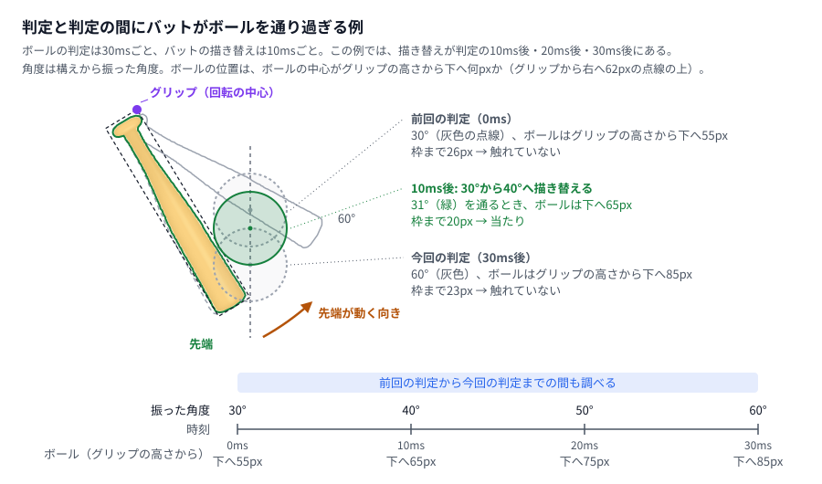
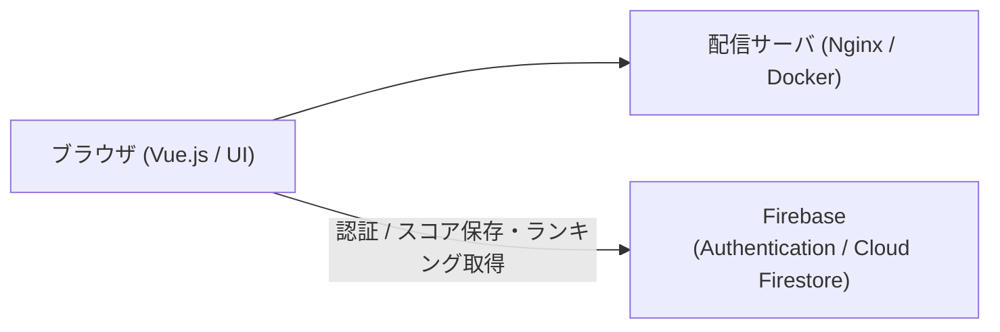

# BaseballGame

ブラウザで遊ぶ野球ゲーム「満塁野球」です。満塁の場面で、自動で投げられるボールを「打つ」ボタンで打ち返し、3アウトまでの得点を競います。

## 主な機能

- 打球が当たった的に応じて、1〜4点の得点か1〜3個のアウトになります。的に当たらずに画面の上端まで飛んだ打球もアウトです。的の数は画面幅に合わせて2〜4個に変わります。
- Googleアカウント（Firebase Authentication）でログインするか、ゲストとして遊べます。
- 結果をCloud Firestoreに保存し、直近7日間（画面上は「今週」）と歴代の得点ランキングを上位10件ずつ表示します。記録はログインユーザー・ゲスト番号ごとに1件で、保存すると上書きします。ログインユーザーは自分の記録を削除できます。

## バットの当たり判定

角度は、構えを0°とし、振る向き（画面上で反時計回り）を正とした「振った角度」で表します。

| 項目 | 決まり |
| --- | --- |
| 判定に使うバットの形 | バットの画像の枠（幅20px・長さ120pxの長方形）を、グリップの端（枠の右上の角）を中心に、振った角度だけ回したもの |
| 当たり | どの角度でも、ボール（半径20pxの円）が枠に重なれば当たり。ボールの中心から枠までの距離が20px以内のとき |
| バットの振り方 | 「打つ」を押すと、グリップの端を中心に、先端が下から右へ回る。押すとすぐ10°の状態を描き、その後10msごとに10°ずつ描き替える。90°まで振ったら、次の描き替えで構え（0°）へ戻す |
| 判定のタイミング | ボールを動かす30msごと。前回の判定から今回の判定までの間に触れていた場合も当たり |

判定と判定の間は、次のようにみなします。

- ボールは、前回の判定の位置から今回の判定の位置まで一定の速さで動く。
- バットは描いた角度に止まっていて、振る向きに描き替えた瞬間に、その間の角度を通る。構えに戻るときは、間の角度を通らない。

次の図は、この決まりを当てはめたものです。ボールの位置は、ボールの中心がグリップの高さ（90°の図では上のライン）から上・下へ何pxかで表します。

### バットとボールの配置



ボールは打たれるまで横に動かず、ボールの通り道の上を下へ動きます。グリップからボールの通り道までの62pxは、画面の幅によらず同じです。

### 当たりの範囲



ボールの上側がバットの下のラインに触れるだけの場合も、画面上は当たって見えるため当たりにしています（90°では、ボールの中心が下のラインから下へ20pxまで）。

グリップからボールの通り道までの62pxとバットの長さで、振った角度ごとにバットが届くボールの高さが決まります。上の図の例は、次の図の30°・60°・90°の位置にあたります。



### 判定と判定の間



ボールは判定した直後に次の位置へ描き替わり、次の判定まで動きません。その間にバットは描き替わるため、判定の時点では外れでも、その間の画面ではバットがボールに重なって見えることがあります。

図の例では、判定でみなすボールは下へ55pxから85pxへ、1msに1pxずつ動きます。5msに30°から40°へ描き替えるとき、33°で下へ60pxのボールに触れるため、当たりになります。

## ゲスト番号

| 場面 | ゲスト番号 |
| --- | --- |
| 未ログインで開始画面を開く | 発番して開始画面に表示する。遊ばずに閉じても番号は消費する |
| ログイン済みで開始画面を開く | 発番しない |
| 「ゲストとして開始」を押す | 発番済みの番号を使う。まだ番号がなければ発番する |
| 結果画面の「保存せずにリトライ」を押す | 同じ番号を使う |

発番では、Firestoreの `guests/_sequence` にある `lastNumber` をトランザクションで1つ増やします。`guests/_sequence` がまだないときだけ、既存のゲストIDから最大の番号を1件読んで引き継ぎます。件数の集計や全件の取得はしません。

発番にはオンライン接続とカウンターの読み書き権限が必要です。通信・利用枠の問題で発番できない場合は開始画面から再試行でき、ランダム番号での代用はしません。通信断や保存せず終了したプレイにより、ランキングに並ぶ番号には欠番が生じます。

カウンターはランキング用のフィールドを持たず、ランキングには表示されません。発行済み番号の再利用を防ぐため、`guests/_sequence` を削除したり `lastNumber` を減らしたりしないでください。ゲストのスコア用ドキュメントは結果保存時に作成します。

## システム構成



| 区分 | 使用技術 |
| --- | --- |
| 画面 | Vue.js 2・Bootstrap 5・Bootstrap Icons（いずれもCDNから読み込む） |
| ビルド | webpack、Babel、Gulp、Dart Sass |
| 外部サービス・配信 | Firebase（Authentication・Cloud Firestore・Analytics）、Nginx、Docker Compose |

## 開発環境のセットアップ

Node.js 24を使います。Firebaseの接続設定は `application/.env` に書きます。キーは `application/src/application/firebase/index.js` が読む `FIREBASE_` で始まる環境変数で、値はビルド時にdotenv-webpackがバンドルへ埋め込みます。

### 1. 依存パッケージのインストール

```bash
cd application
yarn install
```

### 2. ローカル開発サーバの起動

```bash
# Webpack Dev Server を起動（JS・SCSS・画像の変更でライブリロード）
yarn gulp
```

ブラウザで `http://localhost:4000` を開きます。

### 3. Docker Compose による配信確認

```bash
# プロジェクトルートで実行
docker compose up -d
```

Nginxが `application/dist`（`yarn gulp` の出力）を `https://localhost` で配信します。証明書はイメージの作成時に生成する自己署名証明書のため、ブラウザが警告を表示します。

## ビルドとテスト

```bash
cd application

# 本番用ビルド（静的解析・バンドル・スタイル生成）
yarn gulp:build

# 本番用ビルドの後に単体テストを実行
yarn test

# lint・整形の確認
yarn lint
yarn format:check

# Firebaseをメモリ内のモックに置き換えた、ブラウザ確認用のビルド（.test-browser/ に出力）
yarn test:browser:build
```

ブラウザ確認用のビルドは実際のFirebaseに接続しないため、認証・権限・インデックスの確認には使えません。`.test-browser/` を静的ファイルとしてローカルで配信して開きます。デプロイには使いません。

## ディレクトリ構成

```text
BaseballGame/
├── application/             # ゲームクライアントのソースコード
│   ├── src/                 # 画面（index.html・Vueインスタンス）、ゲーム進行、Firebase連携
│   ├── tests/               # 単体テスト（node:test）と、Firebaseをモックしたブラウザ確認用ビルド
│   └── package.json
├── docs/images/             # READMEの図（バットの当たり判定）
├── web/                     # NginxのDockerfileと設定
└── docker-compose.yaml      # コンテナ実行定義
```