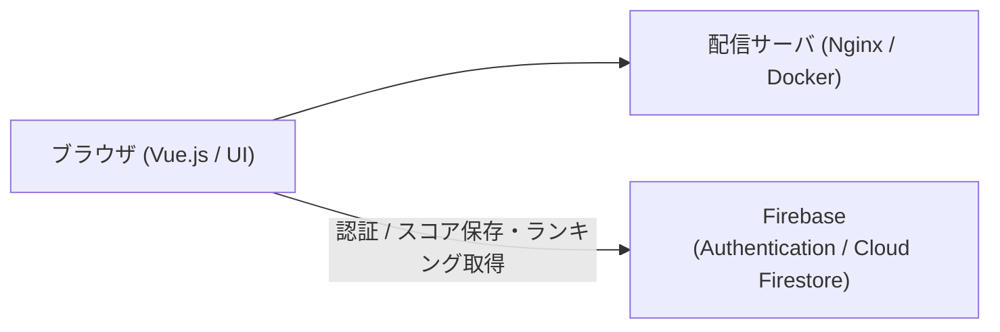

# BaseballGame

ブラウザで遊ぶ野球ゲーム「満塁野球」です。満塁の場面で、自動で投げられるボールを「打つ」ボタンで打ち返し、3アウトまでの得点を競います。

## 主な機能

- 打球が当たった的に応じて、1〜4点の得点か1〜3個のアウトになります。的に当たらずに画面の上端まで飛んだ打球もアウトです。的の数は画面幅に合わせて2〜4個に変わります。
- Googleアカウント（Firebase Authentication）でログインするか、ゲストとして遊べます。
- 結果をCloud Firestoreに保存し、直近7日間（画面上は「今週」）と歴代の得点ランキングを上位10件ずつ表示します。記録はログインユーザー・ゲスト番号ごとに1件で、保存すると上書きします。ログインユーザーは自分の記録を削除できます。

## バットの当たり判定

角度は、構えを0°とし、振る向き（画面上で反時計回り）を正とした「振った角度」で表します。コードの `batRotateDegree` はCSSの `rotate` に渡す値で、反時計回りを負で表すため、振った角度の符号を変えた値になります。

| 項目 | 決まり |
| --- | --- |
| 判定に使うバットの形 | バットの画像の要素の枠（幅20px・長さ120pxの長方形）を、グリップの端（枠の右上の角）を中心に、振った角度だけ回したもの。位置は、回転前の要素の位置と振った角度から求める |
| 当たり | どの角度でも、ボール（半径20pxの円）が枠に重なれば当たり。ボールの中心から枠までの距離が20px以内のとき |
| バットの振り方 | 「打つ」を押すと、グリップの端を中心に、先端が下から右へ回る。押すとすぐ10°の状態を描き、その後10msごとに10°ずつ描き替える。100°に達したら描かずに構え（0°）へ戻す |
| 判定のタイミング | ボールを動かす30msごと。前回の判定から今回の判定までの間も、ボールが1px、バットが1°動くごとに調べ、間で触れていれば当たり |

判定と判定の間は、次のようにみなします。

- ボールは、前回の判定の位置から今回の判定の位置まで一定の速さで動く。
- バットは描いた角度に止まっていて、振る向きに描き替えた瞬間に、その間の角度を通る。構えに戻るときは、間の角度を通らない。

次の図は、この決まりを特定の角度とボールの位置に当てはめた例です。ボールの位置は、ボールの中心がグリップの高さ（90°の図では上のライン）から上・下へ何pxかで表します。

### バットとボールの配置


62pxは、グリップからボールの通り道（ボールの中心が通る縦の線）までの横の距離です。ボールは打たれるまで横に動かず、この線の上を下へ動きます。この距離は画面の幅によらず、バットとボールの要素の配置（[index.html](application/src/index.html) の位置のクラスと、[index.js](application/src/application/vue/index.js) の `batStyleComputed`・`ballStyleComputed`）で決まります。

この距離とバットの長さで、振った角度ごとにバットが届くボールの高さが決まります。バットは21°から届きます。値は1px単位で、範囲の内側へ丸めています。

| 振った角度 | 当たりになるボールの中心の高さ（グリップの高さから） |
| --- | --- |
| 0° | 届かない |
| 10° | 届かない |
| 20° | 届かない |
| 30° | 下へ68px〜下へ125px |
| 40° | 下へ43px〜下へ124px |
| 50° | 下へ26px〜下へ104px |
| 60° | 下へ13px〜下へ81px |
| 70° | 下へ2px〜下へ65px |
| 80° | 上へ9px〜下へ51px |
| 90° | 上へ20px〜下へ40px |

### 当たりの範囲


90°（水平）では、ボールの中心が上のラインから上へ20px〜下へ40px（下のラインから下へ20px）の範囲で当たりです。ボールの上側が下のラインに触れるだけの場合も、画面上は当たって見えるため当たりにしています。

### 判定と判定の間


ボールは判定した直後に次の位置へ描き替わるため、判定と判定の間の画面には、新しいボールの位置と途中のバットの角度の組み合わせが出ます。図の例（30pxずつ動く投球で、バットの描き替えが判定の5ms後・15ms後・25ms後）では、0msと30msの判定はどちらも外れですが、その間の画面では30°・40°・50°のバットがボールに重なります。

| 時刻 | 画面のバット | 画面のボール | 判定でみなすボール |
| --- | --- | --- | --- |
| 0ms（判定） | 30° | 下へ55px（判定の直後に下へ85px） | 下へ55px |
| 5ms | 40° | 下へ85px | 下へ60px |
| 15ms | 50° | 下へ85px | 下へ70px |
| 25ms | 60° | 下へ85px | 下へ80px |
| 30ms（判定） | 60° | 下へ85px | 下へ85px |

判定と判定の間も調べると、5msに30°から40°へ描き替えるとき、33°で下へ60pxのボールに触れるため、当たりになります。

## ゲスト番号

未ログインで開始画面を開いたときに、Firestoreの `guests/_sequence` にある `lastNumber` をトランザクションで1つ増やして発番します。取得した番号を開始画面に表示し、開始ボタン・再プレイでは再利用します。画面を開くだけでも番号を1つ消費します。ログイン済みの場合は画面表示時に発番しません。初回のみ既存ゲストIDの最大番号を1件取得して引き継ぎ、通常の発番で件数集計や全件取得は行いません。

発番にはオンライン接続とカウンターの読み書き権限が必要です。通信・利用枠の問題で発番できない場合は開始画面から再試行でき、ランダム番号での代用はしません。通信断や保存せず終了したプレイにより、ランキングに並ぶ番号には欠番が生じます。

カウンターはランキング用のフィールドを持たず、ランキングには表示されません。発行済み番号の再利用を防ぐため、`guests/_sequence` を削除したり `lastNumber` を減らしたりしないでください。ゲストのスコア用ドキュメントは結果保存時に作成します。

## システム構成



| 区分 | 使用技術 |
| --- | --- |
| 画面 | Vue.js 2・Bootstrap 5（どちらもCDNから読み込む） |
| ビルド | webpack、Babel、Gulp、Dart Sass |
| 外部サービス・配信 | Firebase（Authentication・Cloud Firestore・Analytics）、Nginx、Docker Compose |

## 開発環境のセットアップ

Node.js 24を使います。Firebaseの接続設定は `application/.env` に書きます。キーは `application/src/application/firebase/index.js` が読む `FIREBASE_` で始まる環境変数で、値はビルド時にdotenv-webpackがバンドルへ埋め込みます。

### 1. 依存パッケージのインストール

```bash
cd application
yarn install
```

### 2. ローカル開発サーバの起動

```bash
# Webpack Dev Server を起動（JS・SCSS・画像の変更でライブリロード）
yarn gulp
```

ブラウザで `http://localhost:4000` を開きます。

### 3. Docker Compose による配信確認

```bash
# プロジェクトルートで実行
docker compose up -d
```

Nginxが `application/dist`（`yarn gulp` の出力）を `https://localhost` で配信します。証明書はイメージの作成時に生成する自己署名証明書のため、ブラウザが警告を表示します。

## ビルドとテスト

```bash
cd application

# 本番用ビルド（静的解析・バンドル・スタイル生成）
yarn gulp:build

# 本番用ビルドの後に単体テストを実行
yarn test

# lint・整形の確認
yarn lint
yarn format:check
```

## ディレクトリ構成

```text
BaseballGame/
├── application/             # ゲームクライアントのソースコード
│   ├── src/                 # 画面（index.html・Vueインスタンス）、ゲーム進行、Firebase連携
│   ├── tests/               # 単体テスト（node:test）と、Firebaseをモックしたブラウザ確認用ビルド
│   └── package.json
├── docs/images/             # READMEの図（バットの当たり判定）
├── web/                     # NginxのDockerfileと設定
└── docker-compose.yaml      # コンテナ実行定義
```